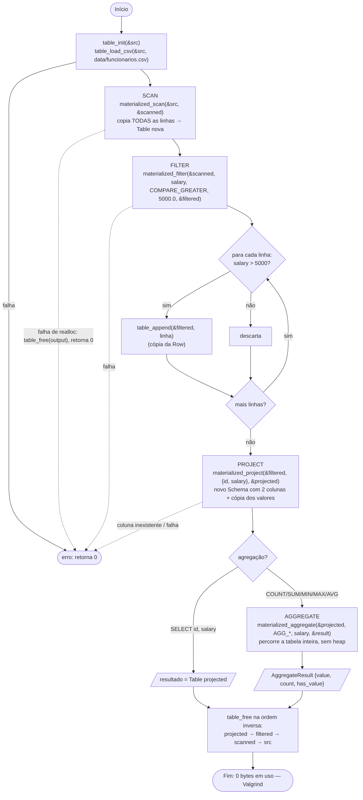

# Etapa 2 — Pipeline de operadores no modelo materializado

Grupo A (Materialização) — Rafael Lima Dias

Este documento descreve a etapa 2 como foi entregue: os operadores SCAN, FILTER,
PROJECT e AGGREGATE no modelo materializado, o gerenciamento de memória e a
validação com o Valgrind. O código exato dessa entrega está na tag
`etapa2-relatorio`. Na etapa 3 a forma de guardar as linhas mudou, mas o modelo de
execução e os contratos descritos aqui continuam valendo. A mudança está explicada
em [etapa3.md](etapa3.md#4-decisões-de-implementação).

## 1. Modelo de execução

Há duas formas principais de executar um plano de consulta. No modelo pipeline
(iterador), as tuplas passam de um operador para o outro à medida que são
produzidas. No modelo **materializado**, cada operador consome a relação de entrada
**inteira** e grava todo o resultado numa relação temporária, que só então é lida
pelo operador seguinte. O Grupo A implementa o modelo materializado: cada operador
devolve uma `Table` completa e independente, e nenhum operador guarda ponteiro
para a tabela anterior.

```text
Table fonte ─SCAN→ Table scanned ─FILTER→ Table filtered ─PROJECT→ Table projected ─AGGREGATE→ AggregateResult
```

Não há parser SQL. A consulta é montada no código, encadeando chamadas e passando
os nomes das colunas como argumentos. A consulta de referência da etapa é

```sql
SELECT AVG(salary)
FROM (SELECT id, salary FROM funcionarios WHERE salary > 5000);
```

que corresponde ao exemplo `SELECT id, salario WHERE salario > 5000` do enunciado,
seguido de uma agregação. O código segue o padrão do repositório (código em
inglês), então as colunas se chamam `id`, `department`, `salary` e `age`. O
cabeçalho do CSV, em português (`id,departamento,salario,idade`), é ignorado na
leitura, e os campos são lidos pela ordem do esquema.

## 2. Arquitetura

### 2.1 Módulos

| Arquivo | Responsabilidade |
|---|---|
| `include/table.h`, `src/table.c` | Modelo de dados (`Schema`, `Value`, `Row`, `Table`), vetor dinâmico de linhas e leitura de CSV tipada pelo esquema |
| `include/materialized.h` | API dos operadores, `QueryMetrics`, `Comparison`, `AggregateFunction`, `AggregateResult` |
| `src/scan.c` | `materialized_scan` |
| `src/materialized.c` | `materialized_filter`, `materialized_filter_salary_gt`, `materialized_project`, `materialized_project_indices` |
| `src/aggregate.c` | `materialized_aggregate` (`COUNT`, `SUM`, `MIN`, `MAX`, `AVG`) |
| `tests/test_materialized.c` | Testes unitários e o pipeline completo (`test_complete_pipeline`) |
| `Makefile` | Alvos `all`, `test`, `sanitize`, `valgrind`, `bench`, `clean` |

`src/join.c` e `src/group_by.c` são da etapa 3 ([etapa3.md](etapa3.md)).

### 2.2 Estruturas de dados (versão da etapa 2)

Uma `Table` reúne um `Schema` e um vetor dinâmico de `Row`. O esquema guarda nome e
tipo (`INT`, `DOUBLE` ou `STRING`) de até 16 colunas (`TABLE_MAX_COLUMNS`). Cada
`Value` carrega o tipo e uma união com o valor. As strings ficam dentro do próprio
`Value`, num vetor de 128 bytes, e nunca apontam para o buffer de leitura do CSV.

```c
/* Values own their string bytes; no row points into a CSV input buffer. */
typedef struct {
    DataType type;
    union {
        int int_value;
        double double_value;
        char string_value[VALUE_STRING_MAX_LEN];   /* 128 na etapa 2 */
    } as;
} Value;

typedef struct { Value values[TABLE_MAX_COLUMNS]; } Row;

typedef struct {
    Schema schema;
    Row *rows;
    size_t size;
    size_t capacity;
} Table;
```

Em x86-64 com GCC, `sizeof(Value)` era 136 bytes e `sizeof(Row)` era
16 × 136 = 2176 bytes, qualquer que fosse o número de colunas do esquema. Como o
esquema é variável por tabela, a mesma estrutura representa a tabela de
funcionários com 4 colunas e a tabela projetada com 2.

### 2.3 Contrato dos operadores

- A entrada chega como `const Table *input` (somente leitura) e a saída é escrita em
  `Table *output`.
- O retorno é `1` em sucesso e `0` em erro: ponteiro nulo, `input == output`, coluna
  inexistente, tipo incompatível ou falha de alocação.
- Se falhar depois de começar a preencher a saída, o operador chama
  `table_free(output)` antes de retornar.
- Quando `metrics` não é nulo, o operador preenche `QueryMetrics` (`rows_in`,
  `rows_out`, `memory_bytes`, `time_ms`). O tempo vem de `clock()`, ou seja, é tempo
  de CPU.

| Operador | Função | Comportamento |
|---|---|---|
| SCAN | `materialized_scan` | Cria a saída com o esquema da entrada e copia todas as linhas |
| FILTER | `materialized_filter` | Localiza a coluna, exige que o valor tenha o tipo da coluna, avalia `=`, `!=`, `<`, `<=`, `>` ou `>=` e copia as linhas aprovadas |
| FILTER (atalho) | `materialized_filter_salary_gt` | Chama `materialized_filter` com `salary > limite` |
| PROJECT | `materialized_project` | Monta um novo esquema com as colunas pedidas, na ordem pedida, e copia só esses valores |
| PROJECT (índices) | `materialized_project_indices` | Igual ao anterior, recebendo índices validados |
| AGGREGATE | `materialized_aggregate` | Percorre todas as linhas e devolve um único `AggregateResult`, sem alocar heap |

## 3. Fluxograma



Fonte em Mermaid: [fluxograma-etapa2.mmd](fluxograma-etapa2.mmd). O fluxograma
mostra os caminhos de erro e a ordem de liberação das tabelas.

## 4. Pipeline materializado

O encadeamento da consulta de referência, como aparece em `test_complete_pipeline`:

```c
const char *columns[] = { "id", "salary" };
Table source, scanned, filtered, projected;
AggregateResult result;
table_init(&source);
assert(table_load_csv(&source, TEST_CSV_PATH));
assert(materialized_scan(&source, &scanned, NULL));
assert(materialized_filter_salary_gt(&scanned, 5000.0, &filtered, NULL));
assert(materialized_project(&filtered, columns, 2, &projected, NULL));
assert(materialized_aggregate(&projected, AGG_AVG, "salary", &result, NULL));
assert(projected.size == 3 && result.count == 3);
assert(fabs(result.value - (22800.0 / 3.0)) < 0.001);
table_free(&projected);
table_free(&filtered);
table_free(&scanned);
table_free(&source);
```

Cada operador só começa depois que a tabela do anterior está completa. O SCAN não
devolve uma visão da origem, e sim uma cópia: `test_scan_is_independent_materialization`
altera a origem depois do SCAN e confirma que a saída não muda.

| Passo | Chamada | Entrada → saída (`data/funcionarios.csv`, 6 linhas) |
|---|---|---|
| 0 | `table_load_csv` | CSV → `src` (6 linhas, 4 colunas) |
| 1 | `materialized_scan` | 6 → 6 linhas (cópia independente) |
| 2 | `materialized_filter` (`salary > 5000.0`) | 6 → 3 linhas (ids 2, 4 e 6) |
| 3 | `materialized_project` (`id, salary`) | 3 linhas × 4 colunas → 3 linhas × 2 colunas |
| 4 | `materialized_aggregate` | 3 linhas → 1 valor (`AVG = 7600,00`) |
| 5 | `table_free` (ordem inversa) | 0 bytes em uso no fim |

O funcionário de id 3 tem salário exatamente 5000,00 e fica fora do resultado,
porque a comparação é estrita (`COMPARE_GREATER`). O FILTER também é sensível a
tipo: como `salary` é `DOUBLE`, o limite precisa ser `value_double(5000.0)`. Um
`value_int(5000)` é rejeitado, e há teste para isso.

Saída da demonstração da etapa 2 (endereços e tempos omitidos):

```text
== FILTER salary > 5000 (rows=3, capacity=16, memory_bytes=34816)
   metrics: rows_in=6 rows_out=3 memory_bytes=34816
   2  finance      7200.00  41
   4  operations   9100.00  38
   6  engineering  6500.00  31
== PROJECT id, salary (rows=3, capacity=16, memory_bytes=34816)
   id  salary
   2   7200.00
   4   9100.00
   6   6500.00
== AGGREGATE sobre a tabela projetada
   COUNT = 3.00   SUM = 22800.00   MIN = 6500.00   MAX = 9100.00   AVG = 7600.00
```

A tabela projetada ocupava os mesmos 34 816 bytes da filtrada (16 × 2176), porque a
capacidade inicial era de 16 linhas e cada `Row` tinha tamanho fixo.

## 5. Projeção e agregações

A projeção constrói um novo esquema só com as colunas pedidas e copia, para cada
linha, os valores correspondentes. Seleção vazia, coluna inexistente ou mais de 16
colunas retornam erro.

`materialized_aggregate` implementa `COUNT`, `SUM`, `MIN`, `MAX` e `AVG` sobre uma
coluna numérica. `COUNT` não precisa de coluna. Em tabela vazia, `COUNT = 0` e
`SUM = 0` são valores definidos, e `MIN`, `MAX` e `AVG` retornam `has_value = 0`, o
que evita divisão por zero e valores fictícios. Na tabela projetada, as cinco
agregações dão `COUNT 3`, `SUM 22800`, `MIN 6500`, `MAX 9100` e `AVG 7600`
(7200 + 9100 + 6500 = 22 800 e 22 800 / 3 = 7600).

## 6. Gerenciamento de memória

### 6.1 Quem aloca e quem libera

Na etapa 2, a única memória de heap é o vetor de linhas de cada `Table`. Como as
strings ficam dentro do `Value`, não há `malloc` por célula nem por string. Quem cria
uma `Table` é dono do vetor e chama `table_free` depois que o último consumidor
termina.

| Recurso | Quem aloca | Quem libera |
|---|---|---|
| Vetor da tabela fonte | `table_load_csv`, via `table_append` | o chamador, com `table_free` |
| Vetor da saída de SCAN, FILTER e PROJECT | o operador, via `table_append` | o chamador, depois que o operador seguinte termina |
| `AggregateResult` | variável do chamador (pilha) | nada a liberar |
| `Row` temporária (PROJECT, CSV) | pilha da função | fim do escopo; `table_append` copia por valor |
| Strings de célula | parte do `Value` | junto com o vetor da tabela |
| Saída parcial em caso de erro | o operador | o próprio operador, antes de retornar `0` |
| `FILE *` do CSV | `fopen` em `table_load_csv` | `fclose` em todos os caminhos |

### 6.2 Crescimento do vetor e reutilização de buffers

O vetor começa com capacidade 16 e dobra a cada estouro, por `realloc`, com
verificação de overflow no cálculo do tamanho. O código não reutiliza buffers entre
operadores: cada operador aloca uma `Table` nova. O único reaproveitamento é o do
próprio vetor de uma tabela, que o `realloc` pode estender no lugar. Isso é coerente
com o modelo materializado, porque a entrada precisa continuar válida enquanto o
operador a lê. Depois que o consumidor termina, o chamador pode liberar o
intermediário. Como `memory_bytes` é `capacity × sizeof(Row)`, a métrica mede o
buffer reservado, que pode ser maior que o número de linhas.

### 6.3 Validade dos ponteiros

- O vetor de uma tabela e o endereço de uma linha valem até o próximo
  `table_append` que precise crescer o vetor (o `realloc` pode movê-lo) ou até
  `table_free`. A API não guarda esses ponteiros entre operadores.
- Dentro de um operador, a entrada é lida e copiada por valor; nenhum ponteiro para
  ela sobrevive à chamada.
- Os nomes de coluna recebidos como `const char *` só precisam valer durante a
  chamada, porque `schema_add_column` os copia para o novo esquema.
- `input == output` é rejeitado, para o operador não destruir o buffer que lê.
- `table_free` aceita tabela vazia e zera vetor, tamanho, capacidade e esquema, então
  chamá-la duas vezes é seguro.
- A saída precisa chegar vazia: os operadores a inicializam com
  `table_init_with_schema` sem liberar o conteúdo anterior.

### 6.4 Como os vazamentos são evitados

1. Uma única fonte de heap (o vetor da tabela) e um único liberador (`table_free`).
2. Em qualquer falha no meio da materialização, o operador libera a saída parcial
   antes de retornar.
3. `table_load_csv` fecha o arquivo e libera a tabela se encontrar uma linha inválida.
4. As tabelas são liberadas na ordem inversa da criação (`projected`, `filtered`,
   `scanned`, `src`).

### 6.5 Validação com Valgrind

```sh
make valgrind   # valgrind --leak-check=full --show-leak-kinds=all --error-exitcode=1 ./test_materialized
```

Ambiente: Linux (Debian 13), GCC 14.2.0, Valgrind 3.24.0. Resultados registrados na
entrega da etapa 2:

| Programa | Alocações | Liberações | Bytes alocados | Em uso no fim | Erros |
|---|---:|---:|---:|---:|---:|
| `test_materialized` | 81 | 81 | 1 401 373 | 0 | 0 |
| `miniquery` | 24 | 24 | 396 888 | 0 | 0 |
| demonstração da etapa 2 | 7 | 7 | 147 928 | 0 | 0 |

As 7 alocações da demonstração são um vetor para cada uma das quatro tabelas (fonte,
SCAN, FILTER e PROJECT), todas com capacidade 16 (4 × 34 816 = 139 264 bytes), mais
as alocações internas da biblioteca padrão para o arquivo e a saída. `make sanitize`
(AddressSanitizer e UndefinedBehaviorSanitizer) também terminou com
`all materialized tests passed`. Os números da etapa 3 estão em
[etapa3.md](etapa3.md#52-valgrind-e-sanitizers).

## 7. Testes

`make test` compila a suíte com `-std=c11 -Wall -Wextra -Wpedantic -Werror -O2` e
termina com `all materialized tests passed`. Para a etapa 2, os testes cobrem a
leitura do CSV e o esquema, a independência da cópia do SCAN, os limites e erros do
FILTER, a projeção ordenada e seus casos de erro, cada agregação (inclusive em
tabela vazia) e o pipeline completo.

## 8. Dificuldades encontradas

- **Linha de tamanho fixo.** A versão anterior usava uma linha fixa de funcionário
  (`EmployeeRow`), o que impedia projetar colunas em outra ordem ou com esquema
  menor. Ela foi trocada por `Schema` e `Row`/`Value` tipados, com esquema variável
  por tabela, mantendo o formato do CSV.
- **Propriedade das strings.** Ponteiros para o buffer de leitura do CSV ficariam
  inválidos, e strings alocadas por célula aumentariam o risco de vazamento. A
  solução foi embutir as strings no `Value`, ao custo de um limite de tamanho por
  valor e de mais memória por linha.
- **Valor esperado no teste.** O valor esperado da média no teste do pipeline foi
  corrigido para 22 800 / 3 = 7600, a média dos três salários filtrados.
- **Ambiente de validação.** Valgrind, AddressSanitizer e UBSan não estavam
  disponíveis no primeiro ambiente de desenvolvimento. A validação de memória foi
  feita em Linux, com os resultados da seção 6.5.

## 9. Possíveis otimizações

Levantadas na etapa 2 a partir de limitações reais do código. A coluna da direita
indica o que foi feito na etapa 3.

| # | Otimização | Situação na etapa 3 |
|---|---|---|
| 1 | Liberar cada intermediário assim que o consumidor termina, em vez de manter fonte, SCAN, FILTER e PROJECT vivos até o fim | Feita no benchmark da etapa 3 |
| 2 | SCAN sem cópia ou fundido com o FILTER (deixa de ser materialização pura) | Não feita, de propósito |
| 3 | Linha compacta: alocar só as colunas do esquema, em vez de 16 valores de 136 bytes por linha | Feita |
| 4 | Strings fora da linha (pool ou arena) com dono e liberação bem definidos | Não feita; o limite de string foi reduzido |
| 5 | Armazenamento colunar, para PROJECT e AGGREGATE lerem só as colunas usadas | Não feita |
| 6 | Capacidade exata em SCAN e PROJECT, que conhecem `input->size` de antemão | Feita |
| 7 | Arena por consulta, liberando tudo de uma vez | Não feita |
| 8 | Fusão de FILTER e PROJECT e predicados compostos | Não feita |
| 9 | Medição de tempo de parede com repetições e mediana | Feita no benchmark |
| 10 | Leitor de CSV mais robusto (cabeçalho validado, aspas, valores nulos) | Parcial: strings longas demais agora são rejeitadas |
