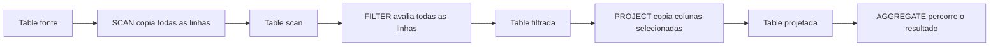

# Etapa 2 — operadores materializados

## Arquitetura

`Table` reúne um `Schema` e um vetor dinâmico de `Row`. O esquema contém nome e
tipo (`INT`, `DOUBLE` ou `STRING`) de até 16 colunas. Uma linha possui valores
tipados para essas colunas; strings residem dentro de `Value`, não em buffers do
CSV. Assim a tabela suporta esquemas com quantidades e combinações de colunas
diferentes, inclusive a tabela projetada.



O programa executa a consulta programática equivalente a:

```sql
SELECT AVG(salary)
FROM (SELECT id, salary FROM funcionarios WHERE salary > 5000);
```

Não há parser SQL: os nomes das colunas são argumentos das APIs.

## Operadores

- `materialized_scan`: copia a tabela de entrada; portanto é um resultado
  materializado e independente, não uma visão da tabela fonte.
- `materialized_filter`: compara uma coluna tipada com `=`, `!=`, `<`, `<=`,
  `>` ou `>=` e copia as linhas aprovadas. O adaptador histórico
  `materialized_filter_salary_gt` usa `salary > limite`.
- `materialized_project` e `materialized_project_indices`: recebem,
  respectivamente, nomes ou índices validados, constroem um novo esquema na
  mesma ordem e copiam apenas os valores solicitados. Seleção vazia, nomes ou
  índices ausentes e mais de 16 colunas retornam erro.
- `materialized_aggregate`: oferece `COUNT`, `SUM`, `MIN`, `MAX` e `AVG` em
  coluna numérica (`COUNT` não precisa de coluna).

Em tabela vazia, `COUNT=0` e `SUM=0` são valores definidos. `MIN`, `MAX` e
`AVG` retornam `has_value=0`, evitando uma divisão por zero ou valor fictício.

## Propriedade e memória

| Recurso | Quem aloca | Proprietário | Quem libera |
|---|---|---|---|
| `Table.rows` | `table_append` via `realloc` | a `Table` receptora | `table_free` |
| strings de célula | fazem parte de `Value` | a própria `Row` | não há `free` separado |
| saída de SCAN/FILTER/PROJECT | o operador, por `table_append` | parâmetro `output` | chamador, após o último consumidor |
| resultado de AGGREGATE | variável do chamador | chamador | não aloca heap |

Cada `table_free` aceita tabela vazia e zera seus campos. A saída de um
operador não pode ser o mesmo objeto da entrada; isso é rejeitado para evitar
perda do buffer durante a materialização. Ponteiros a uma linha são válidos só
até o próximo `table_append` que realoque o vetor ou até `table_free`; a API
não os conserva entre operadores. Se uma alocação falhar, o operador libera a
saída parcial e retorna `0`.

O vetor cresce exponencialmente. Sua capacidade pode exceder o número de linhas
e `memory_bytes` mede o buffer efetivamente reservado. Não há reutilização de
um resultado intermediário enquanto o consumidor ainda o lê; depois disso o
chamador pode liberá-lo imediatamente.

## Métricas, testes e validação

`QueryMetrics` registra `rows_in`, `rows_out`, `memory_bytes` e `time_ms`.
Tempo é CPU time de `clock()` em milissegundos, adequado apenas para uma
demonstração pequena; benchmarks futuros devem repetir execuções e reportar
tempo de parede/mediana.

```sh
make test
make sanitize
make valgrind       # Linux com Valgrind instalado
```

Os testes cobrem CSV, esquema, cópia independente do SCAN, limites do filtro,
projeção ordenada, projeção vazia, erros de coluna/tipo, cada agregação,
tabelas vazias e o encadeamento completo. `make sanitize` usa AddressSanitizer
e UndefinedBehaviorSanitizer. `make valgrind` executa a mesma suíte com falha
quando Valgrind encontra erro ou vazamento.

### Evidência de validação nesta entrega

A suíte foi compilada e executada com GCC 16.2.0, C11, `-Wall -Wextra
-Wpedantic -Werror`, com sucesso. A análise estática adicional com `-fanalyzer`
também não reportou diagnósticos. Neste ambiente Windows não havia `make` ou
Valgrind no `PATH`; a tentativa de sanitizer não foi executável porque a
instalação de GCC não possui `libasan` e `libubsan`. Esses resultados não são
tratados como validação de Valgrind: o alvo `make valgrind` permanece disponível
para ser executado em um ambiente Linux que possua a ferramenta.

## Dificuldades, decisões e próximos passos

A estrutura anterior tinha `EmployeeRow` fixo, o que impossibilitava projetar
colunas em outra ordem ou com esquema menor. A substituição por `Row` tipada
foi necessária para a etapa 2; o CSV de funcionários continua com o mesmo
formato. A escolha de strings embutidas simplifica a propriedade de memória e
elimina vazamentos por célula, em troca de limite de 127 caracteres por valor.

Limitações atuais: leitor CSV específico de funcionários, máximo de 16 colunas,
sem `NULL`, parser SQL, JOIN ou GROUP BY. Para a próxima etapa, as melhorias
mais relevantes são um CSV genérico, armazenamento compacto/dinâmico para
strings, predicados compostos, planejamento de consultas e operadores JOIN.
