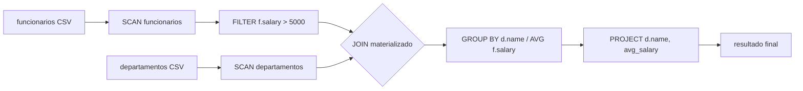

# Etapa 3 — múltiplas relações, JOIN e GROUP BY

## Arquitetura materializada

Esta etapa mantém o modelo do Grupo A: cada operador termina, aloca uma tabela
de saída independente e só então o próximo a consome. `funcionarios` e
`departamentos` possuem seus próprios `Schema` e podem coexistir em memória.
O leitor CSV agora usa o esquema de destino para interpretar `INT`, `DOUBLE` e
`STRING`.



As duas implementações de JOIN recebem aliases. O esquema de saída é sempre
`f.<coluna>` seguido de `d.<coluna>`, portanto nomes repetidos como `id` são
inequívocos (`f.id` e `d.id`) e a escolha do lado de BUILD não muda o formato.

## Operadores

### Nested Loop Join

`materialized_nested_loop_join` percorre cada linha da relação esquerda e a
compara com cada linha da direita. Em igualdade de chave, uma linha combinada é
anexada à saída. É INNER JOIN: linhas sem correspondência não são emitidas;
chaves duplicadas em qualquer lado produzem todas as combinações válidas.

Complexidade: tempo `O(|R| × |S|)` e memória adicional `O(resultado)`, além das
duas entradas materializadas. É simples e serve como referência de correção,
mas não deve ser usado nos cenários de milhões de linhas com produtos
proibitivos.

### Hash Join

`materialized_hash_join` escolhe a menor relação para BUILD. Ela cria um vetor
de buckets e encadeia nós por bucket; cada nó guarda o índice da linha de BUILD.
Na fase PROBE, a relação restante consulta o bucket e valida a igualdade da
chave. A validação após o hash trata colisões; a lista encadeada retém todas as
linhas de chave duplicada. Ao emitir, o código reconstrói explicitamente a
ordem canônica `f` seguida de `d`.

Complexidade esperada: `O(|R| + |S| + resultado)` no tempo e
`O(min(|R|, |S|) + resultado)` na memória. No pior caso de muitas colisões, o
tempo pode degradar. A estrutura hash é destruída antes de a função retornar;
as métricas registram seu pico estimado.

### GROUP BY

`materialized_group_by` aceita uma ou mais colunas de agrupamento, inteiras ou
textuais, e produz uma nova tabela: chaves do grupo seguidas por uma coluna
`DOUBLE` de resultado. Suporta `COUNT`, `SUM`, `MIN`, `MAX` e `AVG`. A estratégia
é uma busca linear nos grupos já materializados, adequada à finalidade didática:
`O(n × g)` no tempo e `O(g)` para os estados, onde `g` é o número de grupos.
Uma tabela vazia retorna zero grupos.

## Consulta demonstrada

`miniquery` executa ambos os JOINs para:

```sql
SELECT d.nome, AVG(f.salario)
FROM funcionarios f
JOIN departamentos d ON f.departamento_id = d.id
WHERE f.salario > 5000
GROUP BY d.nome;
```

No dataset pequeno versionado, as duas estratégias retornam os grupos
`engineering: 6500`, `finance: 7600`, `finance-remote: 7600` e
`operations: 9100`. A linha com `departamento_id=99` é filtrada antes do JOIN,
mas não tem correspondência e não aparece no resultado.

## Memória e validade

`Table.rows` é propriedade da própria tabela e é liberada exclusivamente por
`table_free`. SCAN, FILTER, PROJECT, JOIN e GROUP BY criam suas próprias
tabelas; o chamador libera a saída assim que seu último consumidor termina.
JOIN e GROUP BY rejeitam usar o mesmo objeto como entrada e saída. Strings são
embutidas em `Value`, então copiar uma linha é uma cópia profunda dos seus
dados textuais. Ponteiros para linhas podem ser invalidados por `table_append`
ou `table_free` e nunca são retidos depois da chamada do operador.

Em falhas de alocação, a saída parcial e os buckets/estados auxiliares são
liberados antes de retornar erro. No Hash Join, os buckets são auxiliares e não
fazem parte da tabela retornada.

## Métricas e benchmarks

`JoinMetrics` registra `build_rows`, `probe_rows`, `rows_out`, tempos de BUILD,
PROBE e total, `memory_bytes`, `hash_table_entries` e `hash_table_bytes`.
`memory_bytes` no Hash Join é o pico estimado de buckets/nós mais buffer da
saída; no Nested Loop é o buffer da saída. Os tempos vêm de `clock()` e, neste
dataset pequeno, podem aparecer como `0.000` pela resolução do relógio.

```sh
make bench
cat bench/results.csv
python3 bench/generate_data.py --employees 10000 --departments 100 \
  --selectivity 0.10 --matched-ratio 1.0 \
  --employee-file /tmp/funcionarios.csv --department-file /tmp/departamentos.csv
./miniquery_bench /tmp/funcionarios.csv /tmp/departamentos.csv
```

O gerador é determinístico (`--seed 2026`) e permite cardinalidade, tamanho de
BUILD, seletividade de salários e fração de chaves correspondentes. Nesta
entrega foi executado apenas o cenário versionado de 8 funcionários e 5
departamentos; nenhum resultado de cardinalidades grandes é alegado. Para 100
mil ou mais linhas, use Hash Join; não execute Nested Loop sem limitar o
produto das cardinalidades. `bench/results.csv` é gerado e ignorado pelo Git.

Medição efetivamente executada nesta entrega (dataset versionado, 8 × 5):

| algoritmo | linhas de saída | tempo total (ms) | memória (bytes) |
|---|---:|---:|---:|
| Nested Loop | 9 | 0.000000 | 34816 |
| Hash Join | 9 | 0.000000 | 34984 |

O tempo zero decorre da resolução de `clock()` para uma entrada tão pequena;
não é uma afirmação de desempenho equivalente em entradas maiores.

## Validação e limitações

`make test` cobre a regressão da etapa 2, cargas de ambas as tabelas, aliases,
chaves repetidas, ausência de correspondência, os dois lados possíveis de BUILD,
comparação por multiconjunto entre JOINs, GROUP BY inteiro e textual, todas as
cinco agregações por grupo e a consulta completa com ambos os JOINs.

Neste ambiente foram executadas compilação C11 rigorosa (`-Wall -Wextra
-Wpedantic -Werror`) e a suíte. `make`, Valgrind e as bibliotecas ASan/UBSan não
estavam disponíveis no PATH/instalação local, portanto Valgrind e sanitizers
continuam pendentes e devem ser executados em Linux ou WSL:

```sh
make sanitize
make valgrind
```

Limitações: CSV simples sem aspas/`NULL`, máximo de 16 colunas, strings de até
127 caracteres, GROUP BY linear e sem parser SQL. Evoluções naturais são hash
aggregation, CSV robusto, métricas de tempo de parede com repetições e planner
que escolha o algoritmo de JOIN conforme cardinalidade.
