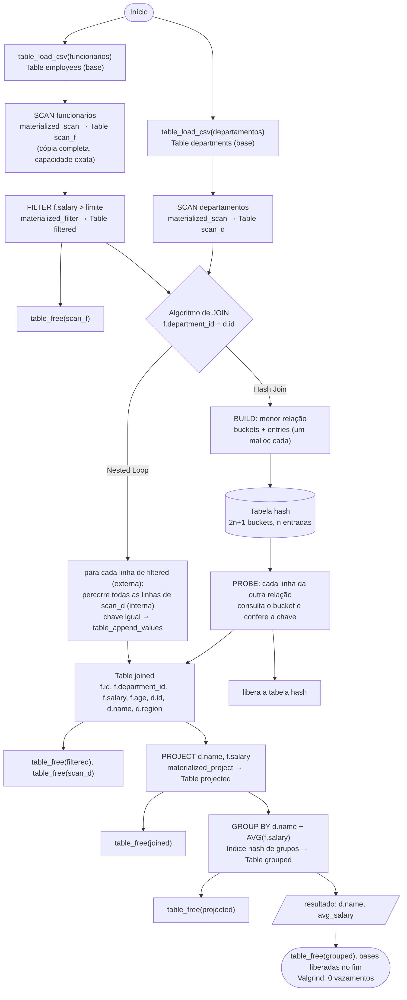
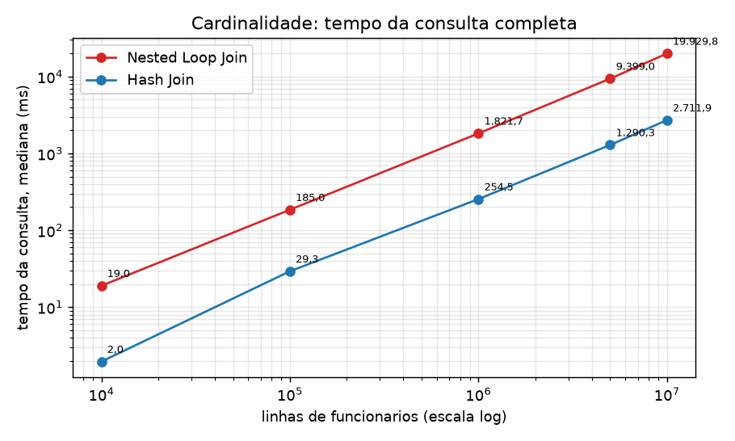
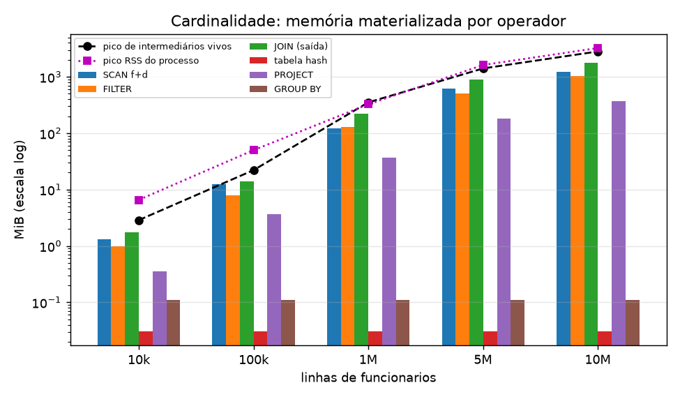
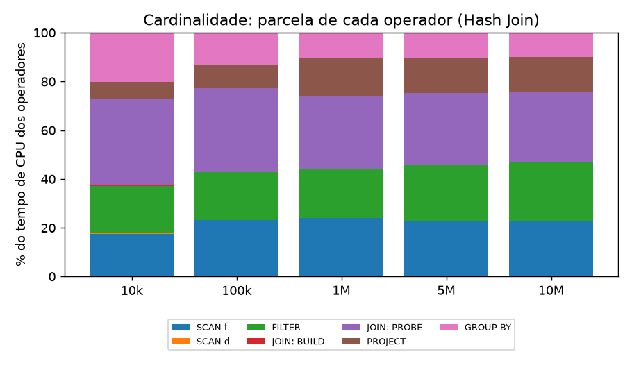
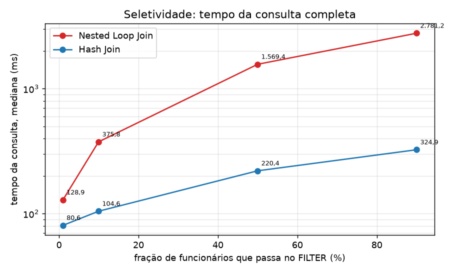
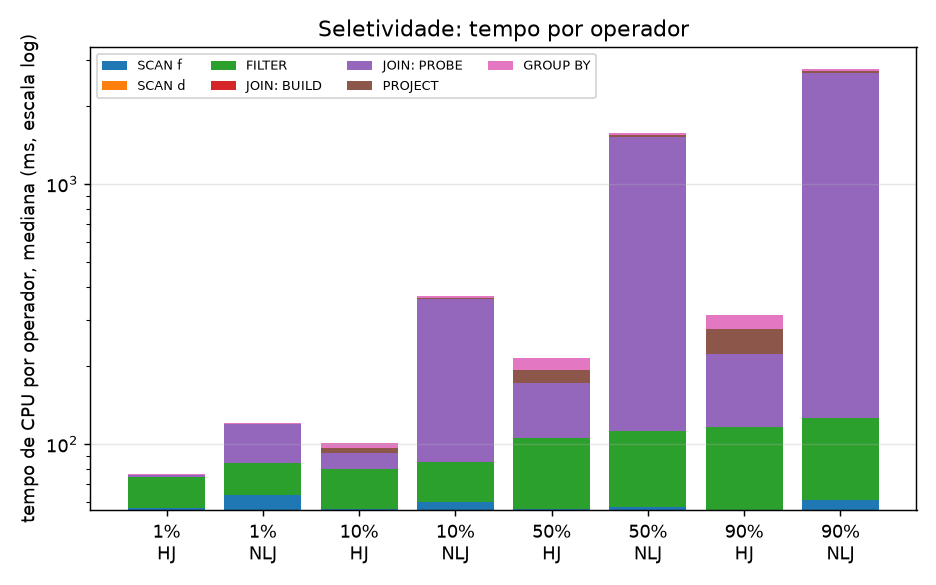
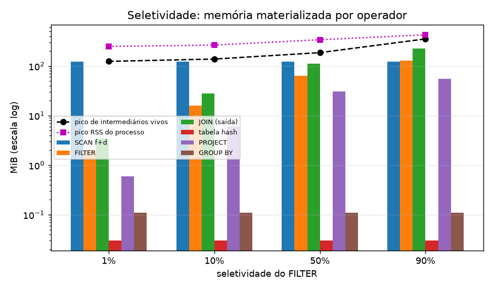
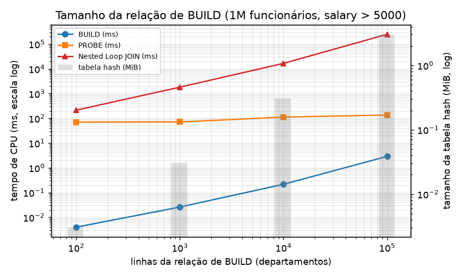
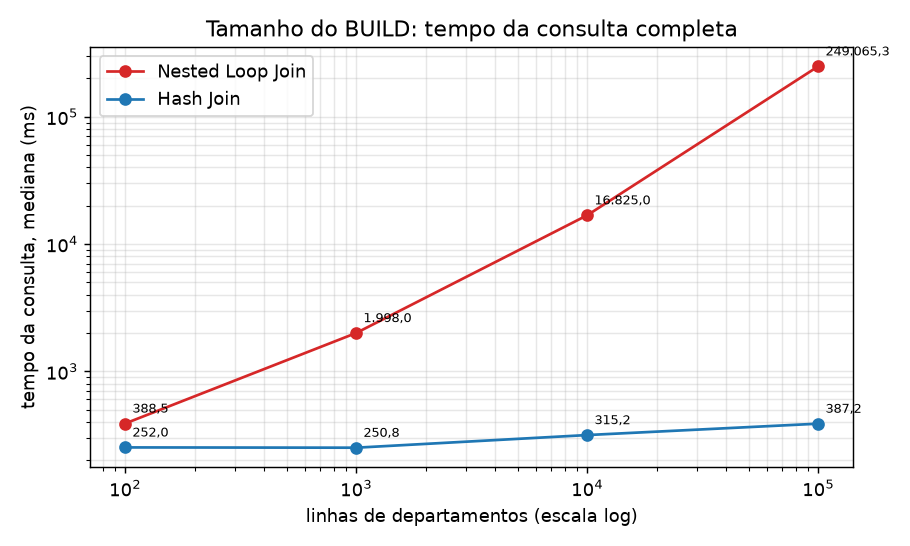

# Etapa 3 — JOIN e execução de consultas (Grupo A: materialização)

Rafael Lima Dias

Este documento cobre as entregas 11.1 a 11.4 do enunciado da etapa 3 para o modelo
**materializado**: suporte a duas tabelas, Nested Loop Join, Hash Join com BUILD e
PROBE explícitos, GROUP BY, instrumentação, testes, os experimentos das seções 8.1 a
8.3 e a resposta à questão da seção 10.

**Escopo.** No repositório, cada modelo de execução é de um grupo: Grupo A
(Materialização), Grupo B (Pipeline) e Grupo C (Vetorizado), cada um no seu branch.
Este trabalho implementa e mede o modelo materializado. As comparações entre
modelos (seção 9 do enunciado) e o teste de tamanho de batch (seção 8.4, a cargo do
responsável pelo modelo vetorizado) dependem das implementações dos outros grupos e
**não foram medidas aqui**. Quando o texto fala de pipeline ou vetorizado, trata-se
de análise do comportamento esperado, e isso está dito explicitamente.

**Entregáveis da seção 11 do enunciado:**

| Item | Onde está |
|---|---|
| 11.1 Código: múltiplas tabelas, Nested Loop Join, Hash Join, GROUP BY, integração, instrumentação, testes | `src/join.c`, `src/group_by.c`, `src/table.c`, `src/main.c`, `include/`, `tests/test_materialized.c`; seções [2](#2-suporte-a-múltiplas-tabelas) a [7](#7-testes-automatizados) |
| 11.2 Experimentos: configuração, datasets, consulta, algoritmo, métricas, tabelas e gráficos | Seção [8](#8-experimentos), `results/` e `docs/img/` |
| 11.3 Documentação técnica: arquitetura, operadores, decisões, memória, dificuldades, limitações, otimizações | Seções [1](#1-arquitetura) a [5](#5-gerenciamento-de-memória) e [10](#10-dificuldades-encontradas) a [12](#12-possíveis-otimizações-futuras) |
| 11.4 Material de extensão | Vídeo curto "Nested Loop Join versus Hash Join e a fase de BUILD", com demonstração no terminal usando `./miniquery` e `./miniquery_bench` (gravado à parte) |
| Questão da seção 10 | Seção [9](#9-resposta-à-questão-da-etapa) |

Sumário:

1. [Arquitetura](#1-arquitetura)
2. [Suporte a múltiplas tabelas](#2-suporte-a-múltiplas-tabelas)
3. [Funcionamento dos operadores](#3-funcionamento-dos-operadores)
4. [Decisões de implementação](#4-decisões-de-implementação)
5. [Gerenciamento de memória](#5-gerenciamento-de-memória)
6. [Instrumentação](#6-instrumentação)
7. [Testes automatizados](#7-testes-automatizados)
8. [Experimentos](#8-experimentos)
9. [Resposta à questão da etapa](#9-resposta-à-questão-da-etapa)
10. [Dificuldades encontradas](#10-dificuldades-encontradas)
11. [Limitações atuais](#11-limitações-atuais)
12. [Possíveis otimizações futuras](#12-possíveis-otimizações-futuras)
13. [Como reproduzir](#13-como-reproduzir)

## 1. Arquitetura

O motor continua baseado no encadeamento de operadores. Cada operador recebe uma ou
duas `Table` completas, executa até o fim e devolve uma `Table` nova e independente.
O operador seguinte só começa quando a anterior está pronta. A consulta completa do
enunciado

```sql
SELECT d.nome, AVG(f.salario)
FROM funcionarios f
JOIN departamentos d ON f.departamento_id = d.id
WHERE f.salario > 5000
GROUP BY d.nome;
```

é executada pelo plano

```text
SCAN funcionarios ── FILTER salary > 5000 ──┐
                                             JOIN ── PROJECT d.name, f.salary ── GROUP BY d.name / AVG
SCAN departamentos ─────────────────────────┘
```

O código segue o padrão do repositório (código em inglês): `departamento_id`,
`salario`, `idade`, `nome` e `regiao` se chamam `department_id`, `salary`, `age`,
`name` e `region`. Os CSV são lidos pela ordem das colunas do esquema.



Fonte do fluxograma: [fluxograma-etapa3.mmd](fluxograma-etapa3.mmd).

| Arquivo | Responsabilidade |
|---|---|
| `include/table.h`, `src/table.c` | `Schema`, `Value`, `Row` (tupla de montagem), `Table` compacta, CSV tipado, `value_equals` e `value_hash` |
| `include/materialized.h` | API dos operadores, `QueryMetrics`, `JoinMetrics` |
| `src/scan.c` | SCAN (cópia com capacidade exata) |
| `src/materialized.c` | FILTER e PROJECT |
| `src/aggregate.c` | AGGREGATE sem agrupamento |
| `src/join.c` | Nested Loop Join, Hash Join (BUILD e PROBE) e impressão das métricas |
| `src/group_by.c` | GROUP BY com índice hash de grupos |
| `src/main.c` | `miniquery`: consulta completa com os dois JOINs, com datasets opcionais pela linha de comando |
| `bench/benchmark.c` | `miniquery_bench`: consulta completa instrumentada, uma linha CSV por repetição |
| `bench/generate_data.py` | Gerador determinístico de `funcionarios` e `departamentos` |
| `bench/run_experiments.py` | Gera os datasets, roda os experimentos e grava `results/raw/` |
| `bench/summarize.py` | Medianas, tabelas (`results/tabelas.md`) e gráficos (`docs/img/`) |
| `tests/test_materialized.c` | Testes das etapas 2 e 3 |

## 2. Suporte a múltiplas tabelas

`funcionarios` e `departamentos` têm esquemas próprios e coexistem em memória como
duas `Table` independentes:

| Tabela | Esquema (`src/table.c`) | Bytes por linha |
|---|---|---:|
| `funcionarios` | `employee_stage3_schema()`: `id INT, department_id INT, salary DOUBLE, age INT` | 4 × 32 = 128 |
| `departamentos` | `department_schema()`: `id INT, name STRING, region STRING` | 3 × 32 = 96 |
| saída do JOIN | `f.id, f.department_id, f.salary, f.age, d.id, d.name, d.region` | 7 × 32 = 224 |
| saída do PROJECT | `d.name, f.salary` | 2 × 32 = 64 |

Cada tabela é carregada e varrida sozinha (`SCAN funcionarios` e
`SCAN departamentos`), e os resultados entram no JOIN. Os pontos pedidos na seção 2
do enunciado ficam assim:

- **Entradas do JOIN.** Duas `const Table *`, a esquerda e a direita, com o nome da
  coluna de chave de cada uma e um alias (`"f"` e `"d"`). As entradas não são
  alteradas.
- **Esquema resultante.** `join_schema` concatena as colunas da esquerda e da direita
  prefixadas pelo alias (`f.id`, ..., `d.region`). Nomes repetidos, como `id`, ficam
  inequívocos. A ordem não depende de qual lado foi usado como BUILD.
- **Tuplas resultantes.** Cada par com chaves iguais vira uma linha da `Table` de
  saída, com os valores da esquerda seguidos dos da direita (`append_joined_row`,
  que copia os valores com `memcpy`). É um INNER JOIN: linhas sem par não aparecem e
  chaves repetidas geram todas as combinações.
- **Alocação.** O JOIN aloca a `Table` de saída (vetor de valores, que cresce por
  `realloc`) e, no Hash Join, a tabela hash.
- **Liberação.** A tabela hash é liberada pelo próprio JOIN antes de retornar. A
  saída pertence ao chamador, que a libera com `table_free` quando o operador
  seguinte termina. Em erro, o JOIN libera a saída parcial e a tabela hash.

## 3. Funcionamento dos operadores

### 3.1 SCAN, FILTER, PROJECT e AGGREGATE

Os operadores da etapa 2 mantêm o contrato (entrada `const`, saída nova, retorno
`1`/`0`, saída parcial liberada em erro, métricas opcionais). Mudanças desta etapa:
o SCAN e o PROJECT reservam a capacidade exata (`input->size`) de uma vez, e todos
leem e gravam pela representação compacta (seção 4.1).

### 3.2 Nested Loop Join

`materialized_nested_loop_join` usa a entrada esquerda como relação externa e a
direita como relação interna. As duas já chegam materializadas. Para cada linha
externa, percorre todas as linhas internas e compara as chaves com `value_equals`.
Tempo `O(|R| × |S|)` comparações e memória adicional só para a saída. Não há fase de
construção, então `build_time_ms = 0`. Nas métricas, `build_rows` é a relação interna
(re-percorrida a cada linha externa) e `probe_rows` é a externa. Na consulta, a
externa é `funcionarios` filtrado e a interna é `departamentos`.

### 3.3 Hash Join: BUILD e PROBE

`materialized_hash_join` escolhe como BUILD a **menor** relação (a esquerda em caso
de empate) e usa a outra como PROBE.

```text
BUILD  (menor relação, já materializada)
  │   para cada linha i: bucket = hash(chave) % (2n + 1); entries[i].next = heads[bucket]; heads[bucket] = i
  v
Tabela hash  heads[2n+1] (size_t) + entries[n] {row_index, next}  →  n × 16 + (2n + 1) × 8 bytes
  │
  v
PROBE  (outra relação)
  │   para cada linha: percorre a cadeia do bucket, confere a chave (colisões e duplicatas) e grava a linha combinada
  v
Resultado  Table materializada f.* + d.*
```

- **BUILD** (`hash_build`) aloca de uma vez o vetor de buckets e o vetor de entradas
  e encadeia as linhas por índice. Não há `malloc` por linha.
- **PROBE** calcula o hash da chave de cada linha, percorre a cadeia inteira do
  bucket, confere a igualdade (a cadeia mistura colisões e chaves repetidas) e grava
  a linha combinada na ordem `f` seguida de `d`.
- A tabela hash é liberada antes de o operador retornar. As métricas guardam o
  tamanho dela.

Tempo esperado `O(|R| + |S| + resultado)`. Memória adicional `O(min(|R|, |S|))` para a
tabela hash, mais a saída.

**Comportamento do Hash Join no modelo materializado**, respondendo aos pontos da
seção 4 do enunciado:

| Pergunta do enunciado | No modelo materializado (medido) | Nos modelos pipeline e vetorizado (esperado, não medido aqui) |
|---|---|---|
| Que partes podem funcionar em pipeline? | Nenhuma: cada operador termina antes do próximo. Dentro do JOIN, o PROBE já processa linha a linha, mas grava tudo numa tabela | O PROBE e tudo que vem depois (PROJECT, acumulação do GROUP BY) podem consumir as linhas à medida que o lado de PROBE as produz |
| Que etapas precisam esperar? | Todas esperam a anterior. O BUILD espera SCAN de departamentos; o PROBE espera BUILD e FILTER | O BUILD precisa consumir a relação inteira antes do primeiro PROBE: é um ponto de bloqueio em qualquer modelo. O GROUP BY também só emite no fim |
| Que estruturas intermediárias são mantidas? | Tabelas de SCAN, FILTER, JOIN e PROJECT, mais a tabela hash durante o JOIN | Só a tabela hash e o estado dos grupos; no vetorizado, também um lote por operador |
| Que etapas consomem mais memória? | A saída do JOIN (224 bytes por linha) e a saída do FILTER, vivas ao mesmo tempo. A tabela hash é pequena: 31 KiB com 1 000 departamentos e 3,1 MiB com 100 000 | A tabela hash do BUILD passa a ser o maior consumidor |
| Como o modelo interfere em BUILD e PROBE? | O BUILD recebe a relação completa de graça, porque ela já está materializada. O PROBE também, mas a saída dele é materializada inteira: com 10 milhões de funcionários, 1,75 GiB reservados | O BUILD continua igual. O PROBE deixa de produzir uma tabela; o custo por linha passa a incluir as chamadas `next()` (pipeline) ou é amortizado por lote (vetorizado) |

### 3.4 GROUP BY e AGGREGATE

`materialized_group_by` aceita uma ou mais colunas de agrupamento (inteiras ou
texto) e uma função (`COUNT`, `SUM`, `MIN`, `MAX` ou `AVG`). A saída é uma `Table` com
as colunas de grupo seguidas de uma coluna `DOUBLE` com o resultado. Os grupos ficam
na ordem da primeira ocorrência. Nesta etapa, a busca linear pelos grupos da versão
anterior (`O(n × g)`) foi trocada por um índice hash de grupos (`heads`, `next` e
estados, que dobram de tamanho quando enchem), com tempo esperado `O(n)`. A mudança
foi necessária para o experimento de BUILD: com 100 000 departamentos, a busca
linear faria até 600 mil × 100 mil comparações só no GROUP BY. O índice e os estados
são liberados antes de o operador retornar. A consulta isolada
`SELECT department_id, AVG(salary) FROM funcionarios GROUP BY department_id` é
coberta pelos testes, e a integrada aparece no fim do plano da seção 1.

## 4. Decisões de implementação

### 4.1 Tabela compacta

Na etapa 2, cada linha ocupava 16 valores de 136 bytes (2176 bytes), qualquer que
fosse o esquema. Com isso, só a tabela base de 10 milhões de funcionários ocuparia
cerca de 20 GiB, e a cópia do SCAN mais 20 GiB, numa máquina de 16 GiB. A linha
compacta, já listada como otimização na etapa 2, foi implementada:

- `Table` guarda `Value *values`, com `schema.column_count` valores por linha em
  sequência (linha `i` começa em `values + i × column_count`).
- `Row` continua existindo, mas só como tupla de montagem na pilha. `table_append`
  copia apenas as colunas do esquema.
- O acesso é feito por `table_cell`, `table_row_const` e `table_row_mut`
  (`static inline` em `table.h`).
- `VALUE_STRING_MAX_LEN` caiu de 128 para 24, e `sizeof(Value)` de 136 para 32 bytes.
  O leitor de CSV agora **rejeita** strings com 24 caracteres ou mais, em vez de
  truncar sem avisar. Os nomes gerados (`department_100000`) têm até 17.

Resultado: `funcionarios` passou de 2176 para 128 bytes por linha (17 vezes menos).

### 4.2 Outras decisões

- **Capacidade exata.** SCAN e PROJECT reservam `input->size` linhas de uma vez. O
  leitor de CSV ajusta o vetor ao tamanho final (`table_shrink_to_fit`). FILTER, JOIN
  e GROUP BY não sabem o tamanho da saída e continuam dobrando a capacidade.
- **Hash Join com BUILD na menor relação**, como pede o enunciado, decidido em tempo de
  execução pelo número de linhas das entradas já materializadas.
- **Tabela hash em dois vetores** (buckets e entradas encadeadas por índice), em vez
  de um `malloc` por nó como na versão anterior: duas alocações por JOIN, liberação
  simples e melhor localidade.
- **Função de hash única** (`value_hash`, djb2 sobre os bytes do `double` ou da
  string, seguida de uma etapa de mistura), usada pelo JOIN e pelo GROUP BY. Inteiros
  e `double` de mesmo valor têm o mesmo hash, coerente com `value_equals`.
- **Ordem do plano.** JOIN → PROJECT → GROUP BY, como no pipeline conceitual do
  enunciado. A versão anterior do `main.c` agrupava antes de projetar.
- **Liberação antecipada no benchmark.** Cada intermediário é liberado assim que o
  consumidor termina, o que torna o pico de memória o maior conjunto de tabelas vivas
  ao mesmo tempo, e não a soma de todas.

## 5. Gerenciamento de memória

### 5.1 Quem aloca e quem libera

| Recurso | Quem aloca | Dono | Quem libera |
|---|---|---|---|
| Vetor de valores das tabelas base | `table_load_csv` (via `table_append`) | chamador | `table_free`, no fim |
| Saída de SCAN, FILTER, PROJECT, JOIN e GROUP BY | o operador | o parâmetro `output` (chamador) | o chamador, depois do último consumidor |
| Tabela hash (`heads`, `entries`) | `hash_build`, dentro do Hash Join | o Hash Join | `hash_table_free`, antes de retornar (também em erro) |
| Índice de grupos (`heads`, `next`, estados) | `materialized_group_by` | o GROUP BY | `group_index_free`, antes de retornar (também em erro) |
| `Row` de montagem e vetor de valores da linha combinada | pilha | a função | fim do escopo |
| Strings | dentro do `Value` | a tabela | junto com o vetor de valores |

Ordem de liberação no benchmark: `scan_f` depois do FILTER; `filtered` e `scan_d`
depois do JOIN; `joined` depois do PROJECT; `projected` depois do GROUP BY. Não há
buffer reutilizado entre operadores. Ponteiros obtidos por `table_cell` e similares
valem até o próximo crescimento da tabela ou `table_free`, e nenhum operador guarda
ponteiro de entrada depois de retornar. `input == output` continua sendo rejeitado.

### 5.2 Valgrind e sanitizers

Executados no código final desta etapa. Logs completos em `results/validacao/`.

| Programa | Alocações | Liberações | Bytes alocados | Em uso no fim | Erros |
|---|---:|---:|---:|---:|---:|
| `test_materialized` (`make valgrind`) | 218 | 218 | 12 881 115 | 0 | 0 |
| `miniquery` (dataset versionado) | 26 | 26 | 38 168 | 0 | 0 |
| `miniquery_bench` Hash Join, 10 mil funcionários | 74 | 74 | 13 548 048 | 0 | 0 |
| `miniquery_bench` Nested Loop, 10 mil funcionários | 72 | 72 | 13 516 040 | 0 | 0 |

`make sanitize` (AddressSanitizer e UndefinedBehaviorSanitizer) terminou com
`all materialized tests passed`. A diferença de 2 alocações entre os dois JOINs no
benchmark corresponde aos dois vetores da tabela hash.

### 5.3 Pico de memória

`memory_bytes` mede a capacidade **reservada** (`capacity × bytes por linha`). O
pico de RSS do processo (`VmHWM`, que inclui as tabelas base) pode ficar abaixo da
soma reservada, porque páginas reservadas e nunca escritas pelo `realloc` não ocupam
memória física. Por isso as tabelas da seção 8 trazem as duas medidas.

## 6. Instrumentação

`JoinMetrics` registra tudo que a seção 5 do enunciado pede, e mais alguns campos:

| Campo | Significado |
|---|---|
| `build_rows`, `probe_rows` | Linhas de BUILD e PROBE (no Nested Loop, relação interna e externa) |
| `rows_out` | Linhas produzidas pelo JOIN |
| `build_time_ms`, `probe_time_ms`, `total_time_ms` | Tempo de CPU (`clock()`) de cada fase e do operador inteiro |
| `memory_bytes` | Tabela hash + saída reservada |
| `hash_table_entries`, `hash_table_bytes` | Entradas e bytes da tabela hash |
| `hash_buckets`, `key_comparisons`, `output_bytes`, `build_is_left` | Extras: buckets, comparações de chave executadas, bytes da saída e lado escolhido para BUILD |

`batch_size` e `batches_processed` são do modelo vetorizado e não se aplicam aqui.
`QueryMetrics` (SCAN, FILTER, PROJECT, GROUP BY) registra `rows_in`, `rows_out`,
`memory_bytes` e `time_ms`. O benchmark mede ainda o tempo de parede da consulta
inteira com `timespec_get` e o pico de RSS do processo. Saída do `./miniquery` no
formato do enunciado (dataset versionado de 8 funcionários e 5 departamentos):

```text
SCAN f: 8 linhas | SCAN d: 5 linhas | FILTER salary > 5000.00: 5 linhas

[HASH_JOIN]
build_rows=5
probe_rows=5
hash_table_entries=5
hash_table_bytes=168
build_time_ms=0.001
probe_time_ms=0.002
total_time_ms=0.004
rows_out=6
memory_bytes=3752
key_comparisons=6
```

O bloco `[NESTED_LOOP_JOIN]` sai antes, com `key_comparisons=25` (5 × 5). Os tempos
variam entre execuções.

## 7. Testes automatizados

`make test` roda 14 grupos de teste:

- **Etapa 2.** CSV e esquema, cópia independente do SCAN, FILTER, PROJECT,
  agregações e pipeline completo.
- **JOIN.** Aliases e esquema resultante, chaves repetidas, chave sem par, os dois
  lados possíveis de BUILD, entrada vazia e equivalência por multiconjunto entre
  Nested Loop e Hash Join em 2 000 × 300 linhas pseudoaleatórias, com chaves
  repetidas e chaves sem par.
- **Métricas.** `key_comparisons = |R| × |S|` no Nested Loop, tamanho exato da tabela
  hash e `memory_bytes` = hash + saída.
- **GROUP BY.** As cinco funções por grupo, chave inteira e texto, e 20 000 linhas em
  5 000 grupos, para forçar o crescimento do índice hash e conferir a ordem e as
  médias.
- **Armazenamento compacto.** Bytes por linha, capacidade exata e rejeição de string
  longa demais no CSV.
- **Consulta completa** na ordem do enunciado, com os valores esperados
  (`engineering 6500`, `finance 7600`, `finance-remote 7600`, `operations 9100`).

`make sanitize` e `make valgrind` rodam a mesma suíte (seção 5.2). Além disso, os
experimentos conferem a cada configuração que os dois algoritmos devolvem o mesmo
número de linhas e a mesma soma das médias por grupo. Não houve divergência.

## 8. Experimentos

### 8.1 Configuração utilizada

| Item | Valor |
|---|---|
| CPU | Intel Xeon (KVM), 8 CPUs lógicas; L1d 48 KiB, L2 2 MiB por núcleo; L3 320 MiB |
| Memória | 15,6 GiB (12,7 GiB disponíveis no início) |
| Sistema | Debian GNU/Linux 13 (trixie), kernel 6.12, máquina virtual compartilhada |
| Compilador | GCC 14.2.0, `-std=c11 -Wall -Wextra -Wpedantic -Werror -O2` |
| Execução | 1 thread, sequencial, um processo por configuração (dataset, algoritmo, limite) |
| Repetições | 1 de aquecimento (descartada) + **5 medidas**; mediana reportada. Sem aquecimento no Nested Loop acima de 5 × 10⁹ comparações |
| Data | 11/11/2026; detalhes em `results/ambiente.txt` |

Os datasets base são carregados uma vez por processo, fora do tempo medido. Cada
repetição executa a consulta inteira de novo, com alocações novas. A máquina é
virtual e compartilhada, então há ruído: a mesma configuração (1 milhão de
funcionários, 1 000 departamentos, `salary > 5000`) foi medida em dois processos
diferentes e deu 254,5 e 250,8 ms com Hash Join e 1 821,7 e 1 998,0 ms com Nested
Loop (cerca de 10% de diferença). As colunas min–max mostram a dispersão dentro de
cada configuração.

### 8.2 Datasets

`bench/generate_data.py` gera dados determinísticos (semente 2026):

- `departamentos`: ids de 1 a D, `name = department_<id>`, `region = region_<id % 5>`.
- `funcionarios`: `department_id` uniforme em 1..D (toda linha tem par), `salary`
  uniforme em [1000, 11000) e `age` uniforme em 18..70.
- Assim, `salary > t` mantém cerca de (11000 − t) / 10000 das linhas.

| Arquivo | Linhas | Tamanho |
|---|---:|---:|
| `funcionarios_10k_d1k.csv` | 10 000 | 0,2 MB |
| `funcionarios_100k_d1k.csv` | 100 000 | 2,1 MB |
| `funcionarios_1m_d1k.csv` (e `_d100`, `_d10k`, `_d100k`) | 1 000 000 cada | 21 a 24 MB |
| `funcionarios_5m_d1k.csv` | 5 000 000 | 114 MB |
| `funcionarios_10m_d1k.csv` | 10 000 000 | 229 MB |
| `departamentos_100.csv` a `departamentos_100k.csv` | 100 a 100 000 | 2,6 KB a 3,2 MB |

`results/datasets.csv` registra tamanho e SHA-256 de cada arquivo. Como o gerador é
determinístico, `make experiments` recria exatamente os mesmos bytes. O enunciado pede
que o dataset esteja no GitHub, mas os arquivos de 5 e 10 milhões passam dos limites
de um repositório comum (o GitHub recusa arquivos acima de 100 MB e alerta acima de
50 MB). Ficam versionados os datasets pequenos, em `data/experimentos/`, e o gerador
com a semente. Os grandes podem ir para o GitHub por Git LFS ou como arquivos
compactados em uma Release (o de 10 milhões tem 93 MB com gzip e 69 MB com xz; os de 1 milhão, cerca de 9 MB com gzip).

### 8.3 Consulta executada e algoritmos

Todas as medições usam a consulta completa da seção 7 do enunciado. Só muda o limite
do FILTER:

```sql
SELECT d.name, AVG(f.salary)
FROM funcionarios f JOIN departamentos d ON f.department_id = d.id
WHERE f.salary > <limite>
GROUP BY d.name;
```

O plano é `SCAN f → FILTER → JOIN ← SCAN d → PROJECT (d.name, f.salary) → GROUP BY/AVG`,
executado com **Nested Loop Join** (externa: `funcionarios` filtrado; interna:
`departamentos`) e com **Hash Join** (BUILD: a menor entrada, que foi sempre
`departamentos`; PROBE: `funcionarios` filtrado).

### 8.4 Métricas coletadas

Por repetição (`results/raw/*.csv`): linhas de cada operador, tempo de CPU de cada
operador (SCAN f, SCAN d, FILTER, BUILD, PROBE, JOIN total, PROJECT, GROUP BY), tempo
de parede da consulta, comparações de chave, entradas e bytes da tabela hash, memória
do JOIN, bytes reservados por cada intermediário, pico de intermediários vivos, pico
de RSS e uma soma de verificação das médias. As medianas estão em
`results/resumo_*.csv` e as tabelas abaixo saíram de `results/tabelas.md`.

Legenda: "Consulta" é o tempo de parede da consulta inteira (mediana); "Memória do
JOIN" é a tabela hash mais a saída reservada; "Pico de intermediários" é o maior
conjunto de tabelas intermediárias vivas ao mesmo tempo; "Pico RSS" é a memória
física máxima do processo, incluindo as tabelas base.

### 8.5 Cardinalidade (seção 8.1 do enunciado)

1 000 departamentos, `salary > 5000` (cerca de 60% das linhas), de 10 mil a 10 milhões
de funcionários. Todas as cardinalidades pedidas foram executadas, inclusive 10
milhões com Nested Loop (6 × 10⁹ comparações, cerca de 20 s por repetição).

| funcionarios | Algoritmo | Linhas no JOIN (probe) | BUILD | rows_out | Comparações de chave | BUILD (ms) | PROBE (ms) | JOIN total (ms) | Consulta, mediana (ms) | min–max (ms) | Memória do JOIN (MiB) | Pico de intermediários (MiB) | Pico RSS (MiB) |
|---|---|---:|---:|---:|---:|---:|---:|---:|---:|---:|---:|---:|---:|
| 10.000 | Hash Join | 5.862 | 1.000 | 5.862 | 8.565 | 0,010 | 0,7 | 0,7 | **2,0** | 1,9–2,0 | 1,8 | 2,9 | 6,6 |
| 10.000 | Nested Loop Join | 5.862 | 1.000 | 5.862 | 5.862.000 | 0,000 | 17,5 | 17,5 | **19,0** | 18,4–23,6 | 1,8 | 2,8 | 6,5 |
| 100.000 | Hash Join | 60.051 | 1.000 | 60.051 | 88.121 | 0,016 | 9,6 | 9,6 | **29,3** | 27,8–34,0 | 14,0 | 22,1 | 50,0 |
| 100.000 | Nested Loop Join | 60.051 | 1.000 | 60.051 | 60.051.000 | 0,000 | 168,4 | 168,4 | **185,0** | 181,2–195,6 | 14,0 | 22,1 | 50,1 |
| 1.000.000 | Hash Join | 600.178 | 1.000 | 600.178 | 879.899 | 0,027 | 71,6 | 71,6 | **254,5** | 246,0–315,4 | 224,0 | 352,1 | 325,5 |
| 1.000.000 | Nested Loop Join | 600.178 | 1.000 | 600.178 | 600.178.000 | 0,000 | 1.645,6 | 1.645,6 | **1.821,7** | 1.786,6–1.971,6 | 224,0 | 352,1 | 325,5 |
| 5.000.000 | Hash Join | 3.000.405 | 1.000 | 3.000.405 | 4.396.861 | 0,029 | 367,6 | 367,6 | **1.290,3** | 1.221,3–1.415,8 | 896,0 | 1.408,1 | 1.619,6 |
| 5.000.000 | Nested Loop Join | 3.000.405 | 1.000 | 3.000.405 | 3.000.405.000 | 0,000 | 8.482,0 | 8.482,0 | **9.399,0** | 9.303,7–9.632,0 | 896,0 | 1.408,1 | 1.619,5 |
| 10.000.000 | Hash Join | 5.999.764 | 1.000 | 5.999.764 | 8.794.780 | 0,027 | 741,2 | 741,2 | **2.711,9** | 2.656,2–2.869,3 | 1.792,0 | 2.816,1 | 3.236,7 |
| 10.000.000 | Nested Loop Join | 5.999.764 | 1.000 | 5.999.764 | 5.999.764.000 | 0,000 | 17.773,9 | 17.773,9 | **19.929,8** | 19.323,4–20.357,6 | 1.792,0 | 2.816,1 | 3.236,7 |

#### Tempo por operador

| funcionarios | Algoritmo | SCAN f | SCAN d | FILTER | JOIN | PROJECT | GROUP BY | Soma dos operadores | Parcela do JOIN |
|---|---|---:|---:|---:|---:|---:|---:|---:|---:|
| 10.000 | Hash Join | 0,3 | 0,0 | 0,4 | 0,7 | 0,1 | 0,4 | 1,9 | 36% |
| 10.000 | Nested Loop Join | 0,4 | 0,0 | 0,4 | 17,5 | 0,2 | 0,4 | 18,9 | 93% |
| 100.000 | Hash Join | 6,4 | 0,0 | 5,4 | 9,6 | 2,7 | 3,6 | 28,1 | 34% |
| 100.000 | Nested Loop Join | 5,7 | 0,0 | 5,2 | 168,4 | 2,5 | 2,7 | 184,1 | 91% |
| 1.000.000 | Hash Join | 57,5 | 0,0 | 48,9 | 71,6 | 37,1 | 25,4 | 245,4 | 29% |
| 1.000.000 | Nested Loop Join | 55,6 | 0,0 | 49,7 | 1.645,6 | 36,3 | 25,4 | 1.812,8 | 91% |
| 5.000.000 | Hash Join | 282,9 | 0,0 | 289,2 | 367,6 | 181,8 | 127,8 | 1.247,5 | 29% |
| 5.000.000 | Nested Loop Join | 287,5 | 0,0 | 249,6 | 8.482,0 | 187,4 | 126,2 | 9.337,2 | 91% |
| 10.000.000 | Hash Join | 580,8 | 0,0 | 634,7 | 741,2 | 362,7 | 257,8 | 2.610,9 | 28% |
| 10.000.000 | Nested Loop Join | 727,1 | 0,0 | 565,7 | 17.773,9 | 432,2 | 250,2 | 19.808,5 | 90% |

#### Dados intermediários (Hash Join)

| funcionarios | SCAN f+d (MiB) | FILTER (linhas / MiB) | JOIN saída (linhas / MiB) | Tabela hash (KiB) | PROJECT (MiB) | GROUP BY (grupos) | Total materializado (MiB) |
|---|---:|---:|---:|---:|---:|---:|---:|
| 10.000 | 1,3 | 5.862 / 1,0 | 5.862 / 1,8 | 31,3 | 0,4 | 997 | 4,6 |
| 100.000 | 12,3 | 60.051 / 8,0 | 60.051 / 14,0 | 31,3 | 3,7 | 1.000 | 38,1 |
| 1.000.000 | 122,2 | 600.178 / 128,0 | 600.178 / 224,0 | 31,3 | 36,6 | 1.000 | 510,9 |
| 5.000.000 | 610,4 | 3.000.405 / 512,0 | 3.000.405 / 896,0 | 31,3 | 183,1 | 1.000 | 2.201,7 |
| 10.000.000 | 1.220,8 | 5.999.764 / 1.024,0 | 5.999.764 / 1.792,0 | 31,3 | 366,2 | 1.000 | 4.403,1 |





O tempo cresce de forma linear com o número de funcionários nos dois algoritmos,
porque o número de departamentos está fixo. O Nested Loop faz |F'| × 1 000
comparações (cerca de 3 ns cada) e gasta 90 a 93% da consulta no JOIN. O Hash Join
faz cerca de 1,47 comparações por linha de PROBE e gasta de 28 a 36% no JOIN. A
diferença entre eles fica estável em cerca de 7 vezes a partir de 100 mil linhas. A
memória também cresce de forma linear: com 10 milhões, a consulta reserva 4,3 GiB de
intermediários para devolver 1 000 grupos, e o pico de intermediários vivos chega a
2,75 GiB, durante o JOIN, quando a saída do FILTER e a do JOIN coexistem.

### 8.6 Seletividade (seção 8.2 do enunciado)

1 milhão de funcionários, 1 000 departamentos. Limites 10900, 10000, 6000 e 2000, que
mantêm 1%, 10%, 50% e 90% das linhas. Seletividades medidas: 0,98%, 9,95%, 50,0% e
90,0%.

| seletividade | Algoritmo | Linhas no JOIN (probe) | BUILD | rows_out | Comparações de chave | BUILD (ms) | PROBE (ms) | JOIN total (ms) | Consulta, mediana (ms) | min–max (ms) | Memória do JOIN (MiB) | Pico de intermediários (MiB) | Pico RSS (MiB) |
|---|---|---:|---:|---:|---:|---:|---:|---:|---:|---:|---:|---:|---:|
| 1.0% (> 10900) | Hash Join | 9.798 | 1.000 | 9.798 | 14.244 | 0,023 | 1,1 | 1,2 | **80,6** | 78,5–82,1 | 3,5 | 124,2 | 247,6 |
| 1.0% (> 10900) | Nested Loop Join | 9.798 | 1.000 | 9.798 | 9.798.000 | 0,000 | 35,0 | 35,0 | **128,9** | 103,6–150,4 | 3,5 | 124,2 | 247,7 |
| 10.0% (> 10000) | Hash Join | 99.519 | 1.000 | 99.519 | 145.589 | 0,024 | 12,1 | 12,2 | **104,6** | 103,0–124,8 | 28,0 | 138,2 | 264,1 |
| 10.0% (> 10000) | Nested Loop Join | 99.519 | 1.000 | 99.519 | 99.519.000 | 0,000 | 275,7 | 275,7 | **375,8** | 370,9–455,9 | 28,0 | 138,2 | 264,1 |
| 50.0% (> 6000) | Hash Join | 500.004 | 1.000 | 500.004 | 732.986 | 0,027 | 66,3 | 66,3 | **220,4** | 217,7–233,3 | 112,0 | 186,2 | 339,0 |
| 50.0% (> 6000) | Nested Loop Join | 500.004 | 1.000 | 500.004 | 500.004.000 | 0,000 | 1.408,0 | 1.408,0 | **1.569,4** | 1.520,7–1.623,5 | 112,0 | 186,2 | 339,0 |
| 90.0% (> 2000) | Hash Join | 900.002 | 1.000 | 900.002 | 1.319.626 | 0,026 | 106,5 | 106,6 | **324,9** | 321,6–328,5 | 224,0 | 352,1 | 426,2 |
| 90.0% (> 2000) | Nested Loop Join | 900.002 | 1.000 | 900.002 | 900.002.000 | 0,000 | 2.530,0 | 2.530,0 | **2.781,2** | 2.729,0–3.079,5 | 224,0 | 352,1 | 426,2 |

#### Tempo por operador

| seletividade | Algoritmo | SCAN f | SCAN d | FILTER | JOIN | PROJECT | GROUP BY | Soma dos operadores | Parcela do JOIN |
|---|---|---:|---:|---:|---:|---:|---:|---:|---:|
| 1.0% (> 10900) | Hash Join | 56,9 | 0,0 | 17,9 | 1,2 | 0,2 | 0,5 | 77,0 | 2% |
| 1.0% (> 10900) | Nested Loop Join | 63,8 | 0,0 | 20,5 | 35,0 | 0,4 | 0,6 | 124,5 | 28% |
| 10.0% (> 10000) | Hash Join | 56,2 | 0,0 | 23,9 | 12,2 | 3,8 | 5,1 | 101,4 | 12% |
| 10.0% (> 10000) | Nested Loop Join | 59,9 | 0,0 | 25,0 | 275,7 | 4,2 | 4,5 | 372,5 | 74% |
| 50.0% (> 6000) | Hash Join | 56,1 | 0,0 | 49,0 | 66,3 | 21,6 | 21,8 | 214,3 | 31% |
| 50.0% (> 6000) | Nested Loop Join | 57,3 | 0,0 | 54,6 | 1.408,0 | 20,6 | 21,4 | 1.561,4 | 90% |
| 90.0% (> 2000) | Hash Join | 55,9 | 0,0 | 60,1 | 106,6 | 53,8 | 37,6 | 313,6 | 34% |
| 90.0% (> 2000) | Nested Loop Join | 61,0 | 0,0 | 64,8 | 2.530,0 | 61,4 | 39,5 | 2.763,1 | 92% |

#### Dados intermediários (Hash Join)

| seletividade | SCAN f+d (MiB) | FILTER (linhas / MiB) | JOIN saída (linhas / MiB) | Tabela hash (KiB) | PROJECT (MiB) | GROUP BY (grupos) | Total materializado (MiB) |
|---|---:|---:|---:|---:|---:|---:|---:|
| 1.0% (> 10900) | 122,2 | 9.798 / 2,0 | 9.798 / 3,5 | 31,3 | 0,6 | 1.000 | 128,4 |
| 10.0% (> 10000) | 122,2 | 99.519 / 16,0 | 99.519 / 28,0 | 31,3 | 6,1 | 1.000 | 172,4 |
| 50.0% (> 6000) | 122,2 | 500.004 / 64,0 | 500.004 / 112,0 | 31,3 | 30,5 | 1.000 | 328,8 |
| 90.0% (> 2000) | 122,2 | 900.002 / 128,0 | 900.002 / 224,0 | 31,3 | 54,9 | 1.000 | 529,2 |





O FILTER decide quantas linhas chegam ao JOIN. De 1% para 90%, a entrada do JOIN
cresce 92 vezes, e o tempo do JOIN acompanha: de 35 para 2 530 ms no Nested Loop e de
1,2 para 106,6 ms no Hash Join. Já o tempo da consulta com Hash Join cresce só 4 vezes
(80,6 → 324,9 ms), porque o SCAN de `funcionarios` custa sempre cerca de 56 ms e
reserva sempre 122 MiB, qualquer que seja o filtro. Com 1%, SCAN e FILTER somam 97% do
tempo dos operadores. É o custo fixo da materialização: a cópia completa feita antes
de o filtro descartar qualquer linha. A vantagem do Hash Join sobre o Nested Loop
cresce com a seletividade: 1,6 vez com 1%, 3,6 com 10%, 7,1 com 50% e 8,6 com 90%.

### 8.7 Tamanho da relação de BUILD (seção 8.3 do enunciado)

1 milhão de funcionários, `salary > 5000`, de 100 a 100 000 departamentos. Como todo
funcionário tem departamento, a saída do JOIN fica perto de 600 mil linhas em todos
os casos, e só o tamanho do BUILD muda. O Nested Loop com 100 000 departamentos
(6 × 10¹⁰ comparações) foi executado por completo: 5 repetições, sem aquecimento,
cerca de 4 minutos cada.

| linhas no BUILD | Algoritmo | Linhas no JOIN (probe) | BUILD | rows_out | Comparações de chave | BUILD (ms) | PROBE (ms) | JOIN total (ms) | Consulta, mediana (ms) | min–max (ms) | Memória do JOIN (MiB) | Pico de intermediários (MiB) | Pico RSS (MiB) |
|---|---|---:|---:|---:|---:|---:|---:|---:|---:|---:|---:|---:|---:|
| 100 | Hash Join | 599.745 | 100 | 599.745 | 852.072 | 0,004 | 70,1 | 70,1 | **252,0** | 246,0–275,9 | 224,0 | 352,0 | 325,2 |
| 100 | Nested Loop Join | 599.745 | 100 | 599.745 | 59.974.500 | 0,000 | 214,2 | 214,2 | **388,5** | 380,9–404,3 | 224,0 | 352,0 | 325,2 |
| 1.000 | Hash Join | 600.178 | 1.000 | 600.178 | 879.899 | 0,026 | 71,2 | 71,2 | **250,8** | 246,9–282,8 | 224,0 | 352,1 | 325,5 |
| 1.000 | Nested Loop Join | 600.178 | 1.000 | 600.178 | 600.178.000 | 0,000 | 1.809,1 | 1.809,1 | **1.998,0** | 1.968,1–2.088,9 | 224,0 | 352,1 | 325,5 |
| 10.000 | Hash Join | 599.676 | 10.000 | 599.676 | 1.154.395 | 0,216 | 112,1 | 112,3 | **315,2** | 293,3–420,0 | 224,3 | 353,2 | 328,1 |
| 10.000 | Nested Loop Join | 599.676 | 10.000 | 599.676 | 5.996.760.000 | 0,000 | 16.565,4 | 16.565,4 | **16.825,0** | 16.050,3–18.433,4 | 224,0 | 352,9 | 327,9 |
| 100.000 | Hash Join | 599.556 | 100.000 | 599.556 | 1.273.291 | 2,896 | 135,5 | 138,4 | **387,2** | 378,6–388,3 | 227,1 | 364,2 | 353,4 |
| 100.000 | Nested Loop Join | 599.556 | 100.000 | 599.556 | 59.955.600.000 | 0,000 | 248.502,4 | 248.502,4 | **249.065,3** | 235.688,7–257.660,8 | 224,0 | 361,2 | 351,2 |

#### Tempo por operador

| linhas no BUILD | Algoritmo | SCAN f | SCAN d | FILTER | JOIN | PROJECT | GROUP BY | Soma dos operadores | Parcela do JOIN |
|---|---|---:|---:|---:|---:|---:|---:|---:|---:|
| 100 | Hash Join | 61,5 | 0,0 | 51,5 | 70,1 | 37,4 | 20,7 | 242,9 | 29% |
| 100 | Nested Loop Join | 56,8 | 0,0 | 49,8 | 214,2 | 37,2 | 20,4 | 380,3 | 56% |
| 1.000 | Hash Join | 58,7 | 0,0 | 50,6 | 71,2 | 36,9 | 25,3 | 240,7 | 30% |
| 1.000 | Nested Loop Join | 63,7 | 0,0 | 56,9 | 1.809,1 | 40,5 | 26,6 | 1.985,1 | 91% |
| 10.000 | Hash Join | 61,0 | 0,5 | 56,0 | 112,3 | 38,9 | 31,0 | 296,9 | 38% |
| 10.000 | Nested Loop Join | 73,5 | 0,6 | 61,9 | 16.565,4 | 49,7 | 31,2 | 16.809,1 | 99% |
| 100.000 | Hash Join | 60,3 | 4,6 | 53,1 | 138,4 | 36,0 | 83,3 | 376,1 | 37% |
| 100.000 | Nested Loop Join | 134,1 | 9,4 | 78,7 | 248.502,4 | 114,4 | 88,1 | 248.981,5 | 100% |




O BUILD é barato e cresce de forma linear: 0,004 ms com 100 linhas e 2,9 ms com 100
mil, com a tabela hash indo de 3,1 KiB para 3,1 MiB. O PROBE quase dobra (70 → 135
ms). Com 100 mil chaves, a tabela hash (3,1 MiB) e as 100 mil linhas de
`departamentos` (9,2 MiB) já não cabem no cache L2 de 2 MiB, e cada linha de PROBE faz
mais acessos aleatórios. O número de comparações por linha de PROBE também sobe de
1,42 para 2,12, um pouco acima do 1,5 esperado para carga 0,5, o que indica que a
função de hash espalha pior chaves maiores. No Nested Loop, o JOIN cresce na
proporção de |D|: de 214 ms com 100 para 248 502 ms (4,1 minutos) com 100 mil
departamentos. O custo por comparação também sobe, de cerca de 3 para 4,1 ns, quando
a relação interna deixa de caber no cache. Com 100 departamentos, o Nested Loop fica
só 1,5 vez mais lento que o Hash Join na consulta inteira. Com 100 mil, 643 vezes.

### 8.8 Tamanho do batch (seção 8.4 do enunciado)

Não se aplica ao modelo materializado: não há lotes entre operadores, e o enunciado
atribui esse teste ao responsável pelo modelo vetorizado.

### 8.9 Comparações obrigatórias (seção 9 do enunciado)

| Comparação | Situação |
|---|---|
| Nested Loop × Hash Join | Medida (seções 8.5 a 8.7) |
| Materialização × Pipeline × Vetorizado | Não medida aqui: depende das implementações de JOIN dos Grupos B e C |
| Cardinalidades, seletividades e tamanhos de BUILD | Medidas |
| Tamanhos de batch | Não se aplica ao Grupo A |
| Consumo de memória, tempo total, tempo por operador, dados intermediários | Medidos (colunas de memória, tabelas "Tempo por operador" e "Dados intermediários") |

Para a comparação entre modelos ser justa, os três grupos precisam usar os mesmos
datasets e a mesma consulta. O gerador e a semente desta etapa ficam no repositório
para isso.

## 9. Resposta à questão da etapa

> Como o modelo de execução e o algoritmo de JOIN influenciam o custo de uma consulta
> composta por scan, filtro, join, projeção e agregação?

Nos experimentos do modelo materializado, o **algoritmo de JOIN** decide a ordem de
grandeza do custo, e o **modelo de execução** decide o custo que sobra, e sobretudo a
memória.

**1. O algoritmo de JOIN define a complexidade.** O Nested Loop compara cada linha
externa com todas as internas, então o custo é proporcional a |F'| × |D|. O Hash Join
paga |D| para construir a tabela e cerca de 1,5 comparação por linha de PROBE. Com 1
milhão de funcionários e 1 000 departamentos, foram 600 milhões de comparações contra
880 mil (682 vezes menos), e o JOIN caiu de 1 645,6 para 71,6 ms (23 vezes). O ganho
em tempo é menor que o ganho em comparações porque cada passo do Hash Join custa mais
(cálculo do hash, acesso aleatório à cadeia) e porque os dois algoritmos pagam a
mesma materialização da saída (224 MiB reservados). O tamanho da relação interna é o
fator decisivo. Com 100 departamentos, o Nested Loop deixa a consulta só 1,5 vez mais
lenta. Com 100 mil, 643 vezes (249 s contra 0,39 s). O Hash Join quase não sente essa
variação (252 → 387 ms), porque o BUILD custa no máximo 2,9 ms.

**2. Filtrar antes do JOIN reduz o custo do JOIN na mesma proporção.** De 90% para 1%
de seletividade, o JOIN do Nested Loop cai de 2 530 para 35 ms (72 vezes) e o do Hash
Join de 106,6 para 1,2 ms. Quanto mais caro o JOIN por linha, mais o filtro compensa.
Por isso a vantagem do Hash Join cai de 8,6 vezes (90%) para 1,6 vez (1%).

**3. Com Hash Join, o que sobra é o custo do modelo materializado.** Quando o JOIN é
eficiente, ele responde por só 28 a 38% do tempo. O resto é SCAN, FILTER, PROJECT e
GROUP BY, e todos gravam a saída inteira. Só o SCAN de `funcionarios` (cópia completa)
e o PROJECT (outra cópia) somam 36% do tempo com 10 milhões de linhas (943 de 2 611
ms). Com seletividade de 1%, SCAN e FILTER são 97% do tempo, porque a tabela inteira é
copiada antes de o filtro descartar 99% dela. Na memória, a consulta de 10 milhões
reserva 4,3 GiB de intermediários (SCAN 1,19 GiB, FILTER 1 GiB, JOIN 1,75 GiB,
PROJECT 366 MiB) para devolver 1 000 linhas. O pico de intermediários vivos chega a
2,75 GiB, e o pico de RSS do processo a 3,2 GiB. Com Hash Join, a tabela hash ocupa só
31 KiB desse total: no modelo materializado, quem consome memória são as tabelas
intermediárias, e não a estrutura do JOIN.

**4. O modelo muda o papel de BUILD e PROBE.** No modelo materializado, o BUILD não
espera mais do que esperaria de qualquer forma, porque a relação de `departamentos`
já está completa. O PROBE, porém, também recebe a entrada inteira e materializa toda a
saída, que é o maior intermediário da consulta. Nos modelos pipeline e vetorizado, que
não foram medidos aqui, o esperado pelo funcionamento dos operadores é que o BUILD
continue sendo um ponto de bloqueio (a tabela hash precisa estar completa antes do
primeiro PROBE), mas que o PROBE, o PROJECT e o GROUP BY passem a consumir as linhas à
medida que elas chegam. Assim, os gigabytes de tabelas intermediárias dariam lugar à
tabela hash e ao estado dos grupos (cerca de 145 KiB com 1 000 departamentos),
mais um lote por operador no vetorizado. Em troca, haveria custo de chamada por tupla
(pipeline) ou por lote (vetorizado). Quanto isso custa de fato só pode ser respondido
com as medições dos Grupos B e C nos mesmos datasets.

**Conclusão.** O custo da consulta é aproximadamente o custo do JOIN mais um custo
proporcional ao volume de dados copiado entre os operadores. O algoritmo de JOIN
define o primeiro termo: o Nested Loop o torna quadrático e dominante (90 a 100% do
tempo quando |D| ≥ 1 000), e o Hash Join o torna linear e secundário. O modelo de
execução define o segundo: no modelo materializado, cada operador copia a sua saída
inteira, o que, com Hash Join, responde pela maior parte do tempo e por toda a memória
que cresce com os dados. Filtros seletivos antes do JOIN reduzem os dois termos,
menos a cópia do SCAN, que a materialização paga sempre.

## 10. Dificuldades encontradas

- **Memória da linha fixa.** A `Row` de 2176 bytes da etapa 2 inviabilizava as
  cardinalidades pedidas: 10 milhões de linhas ocupariam cerca de 20 GiB por tabela. A
  solução foi a tabela compacta (seção 4.1), que exigiu trocar todos os acessos
  `rows[i].values[j]` por funções de acesso.
- **GROUP BY linear.** A busca linear pelos grupos funcionava nos testes, mas tornaria
  o experimento com 100 mil departamentos inviável. Foi trocada por um índice hash
  mantendo a ordem dos grupos, que os testes já verificavam.
- **Custo do Nested Loop nos experimentos.** Com 100 mil departamentos, cada execução
  leva cerca de 4 minutos. Mesmo assim, as 5 repetições foram feitas, só sem a rodada
  de aquecimento.
- **Medição.** `clock()` mede tempo de CPU por operador, e o tempo da consulta inteira
  precisou de relógio de parede (`timespec_get`). A memória reservada e a física são
  diferentes (seção 5.3), por isso ambas são reportadas. A máquina compartilhada
  introduz ruído de até cerca de 10% entre processos.
- **Datasets grandes no GitHub.** Os arquivos de 5 e 10 milhões passam dos limites de um
  repositório comum (seção 8.2).

## 11. Limitações atuais

- Só o modelo materializado; sem comparação medida com pipeline e vetorizado.
- Só INNER JOIN com uma condição de igualdade. Sem planner: o algoritmo é escolhido
  pelo chamador, e só o lado de BUILD é automático.
- Sem parser SQL. As consultas são montadas no código.
- CSV simples: sem aspas, sem `NULL` e sem validação do cabeçalho; strings de até 23
  caracteres; no máximo 16 colunas por tabela.
- Sem verificação de memória disponível antes de materializar: uma entrada grande
  demais termina em falha de alocação (tratada, com liberação).
- Tempos de operador em tempo de CPU; consulta inteira em tempo de parede.
- O FILTER aceita um único predicado.

## 12. Possíveis otimizações futuras

| Otimização | Motivo medido |
|---|---|
| SCAN sem cópia, ou fundido com o FILTER | O SCAN custa de 22 a 23% do tempo e 1,19 GiB com 10 milhões; com 1% de seletividade, SCAN e FILTER são 97% do tempo |
| Projeção antecipada (JOIN gravando só `d.name` e `f.salary`) | A saída do JOIN tem 7 colunas (224 bytes por linha) e é o maior intermediário; só 2 colunas são usadas depois |
| Agregação no próprio PROBE (GROUP BY fundido ao JOIN) | Eliminaria a saída do JOIN e do PROJECT (2,1 GiB com 10 milhões) |
| Melhor função de hash ou endereçamento aberto | 2,12 comparações por linha de PROBE com 100 mil chaves, contra 1,5 esperado |
| Estimar a capacidade da saída do FILTER e do JOIN | A capacidade dobra e chega a reservar quase o dobro do usado (FILTER de 10 milhões: 1 GiB reservado para 732 MiB de linhas) |
| Strings fora da linha (pool por tabela) | O `Value` de 32 bytes existe por causa da string de 24 bytes, e as colunas numéricas pagam esse tamanho |
| Armazenamento colunar | PROJECT e GROUP BY leem 2 de 7 colunas |
| Planner simples | Escolher Nested Loop só quando |R| × |S| for pequeno |
| Hash Join particionado (grace) | Para quando a relação de BUILD não couber na memória |

## 13. Como reproduzir

```sh
make && ./miniquery                        # consulta completa no dataset versionado
make test && make sanitize && make valgrind
make experiments                           # gera os datasets (~440 MB) e roda tudo; o Nested Loop com 100 mil departamentos leva ~21 min
python3 bench/summarize.py                 # medianas, results/tabelas.md e docs/img/*.png (requer matplotlib)
./miniquery data/experimentos/funcionarios_100k_d1k.csv data/experimentos/departamentos_1k.csv 9000
```

Para só uma parte: `python3 bench/run_experiments.py --only seletividade`.
